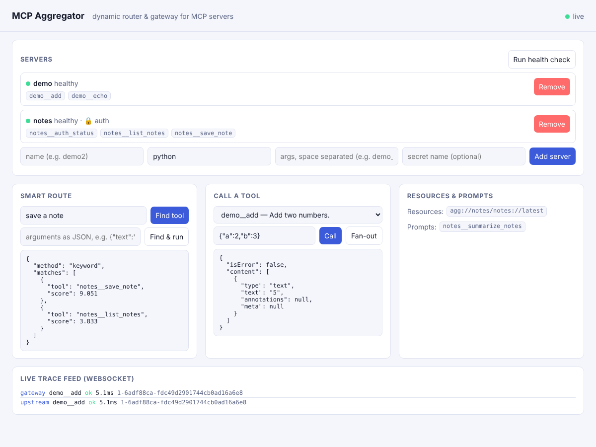

# MCP Server Aggregator & Dynamic Router

A gateway that connects to many downstream MCP servers, discovers their tools / resources / prompts at runtime,
merges them behind one endpoint, and routes each request to the right server.



## Architecture

```
 MCP client (Claude Desktop / IDE)          Browser dashboard
        │ stdio (gateway.py)                       │ HTTP + WebSocket
        └──────────────┬───────────────────────────┘
                       ▼
              ┌──────────────────┐   routing: keyword scoring (offline) or Amazon Bedrock
              │ UpstreamManager  │   policy: block patterns, namespacing  server__tool
              │  + Router        │   fan-out: call_all() merges overlapping servers
              └───┬────┬────┬────┘   health loop + re-discovery, per-server secrets
                  ▼    ▼    ▼
              demo  notes  …  (downstream MCP servers over stdio)

 Registry store : SQLite (local)  ⇄  DynamoDB (AWS)     schema_version=2, v1→v2 migration
 Secrets        : .env (local)    ⇄  AWS Secrets Manager
 Logs / traces  : JSONL + stderr  ⇄  CloudWatch Logs, X-Ray-format trace IDs, per-hop latency
```

## Run locally

```bash
python -m venv .venv && . .venv/bin/activate      # Windows: .venv\Scripts\activate
pip install -r requirements.txt
cp .env.example .env                               # Windows: copy .env.example .env
uvicorn aggregator.api:app --reload                # dashboard at http://localhost:8000
python -m pytest -v                                # run all tests
python evaluate.py                                 # numeric results -> results/results.md
python -m aggregator.gateway                       # run as a stdio MCP server for any MCP client
```

## Checklist coverage — what is verified, and how

| Checklist item | Implementation | Verified by |
|---|---|---|
| MCP fundamentals (tools / resources / prompts) | `upstream.py`, `gateway.py` aggregate all three | `test_manager`, `test_resources`, `test_contract` |
| Dynamic tool discovery at runtime | `add_server` / `remove_server` / `rediscover` | `test_dynamic`, dashboard "Add server" |
| Routing / tool selection | `router.py` keyword (IDF) + Bedrock with fallback | `test_aws` (router tests), `evaluate.py` accuracy |
| Aggregation of overlapping requests | `call_all()` fan-out, `/fanout` | `test_fanout` |
| Per-server auth | secret name per server, injected as `MCP_TOKEN`; never logged or returned | `test_auth` |
| Registry (SQLite → DynamoDB) | `store.py` both backends | `test_store` (DynamoDB via moto) |
| Versioned schema + back-compat test | `SCHEMA_VERSION`, `migrate()` | `test_store::test_backward_compat_v1_record_still_readable` |
| Secrets Manager | `secrets.py` aws backend | `test_aws` (moto) |
| CloudWatch + X-Ray | `CloudWatchSink`, X-Ray-format trace IDs, X-Ray daemon sidecar + IAM in template | `test_aws`, `test_tracing` |
| WebSocket | `/ws` live feed + tool calls | `test_api::test_websocket_call_and_live_feed` |
| Health-check automation | `health_check()` pings, restarts dead servers; `/health/check` | `test_health` |
| Contract tests | real MCP client against the gateway over stdio | `test_contract` |
| CI with mock servers | `.github/workflows/ci.yml`; demo + notes servers are the mocks | GitHub Actions |
| ECS Fargate / API Gateway / EventBridge / Lambda / Bedrock IAM | `deploy/template.yaml` (CloudFormation) | `cfn-lint` (template is valid) |

### Honest status of the AWS parts

* The AWS code paths (DynamoDB, Secrets Manager, CloudWatch) are **tested against `moto`**, an AWS emulator — not against a real AWS account.
* The Bedrock call is tested with a **fake client**; the model's real output has not been exercised.
* `deploy/template.yaml` **passes cfn-lint but has not been deployed**. Deploying needs an AWS account, an ECR image, and a VPC.
  See `deploy/DEPLOY.md`. Do this only after setting a billing alarm; ALB + Fargate cost a few dollars per day if left running — delete the stack afterwards.
* Routing accuracy is measured on a small hand-written set (10 queries) with a small synonym table, so treat it as a demo number, not a benchmark.

## Results (from `python evaluate.py`)

See `results/results.md` (regenerated on every run).
